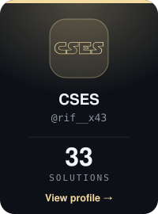
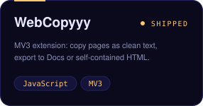
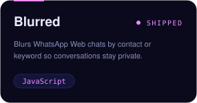
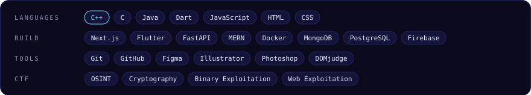
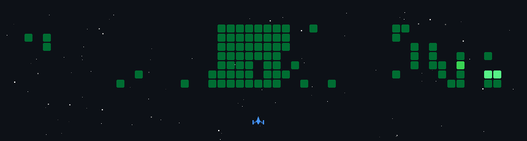

<!-- Header & Intro -->

 

<!-- CP Profiles -->

  

  
  
  
  
  

 

<!-- Achievements -->

  

<code>hackathon builds</code> &nbsp;·&nbsp; <a href="https://github.com/rif-x43/EcoCycle">EcoCycle</a> &nbsp;·&nbsp; ProfMate &nbsp;·&nbsp; CampusOS &nbsp;·&nbsp; <a href="https://github.com/rif-x43/CP-Archive_Codeforces">CP Archive</a>

  

  

