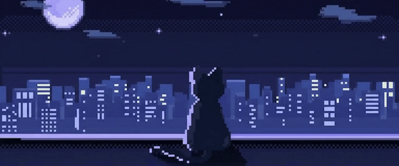
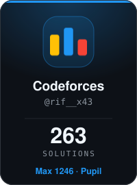
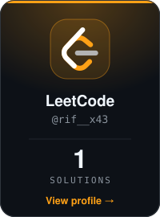
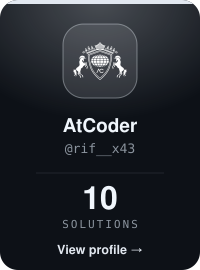
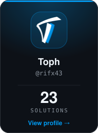
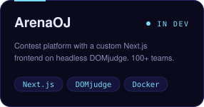
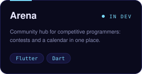
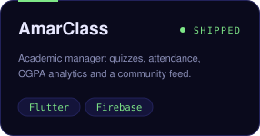
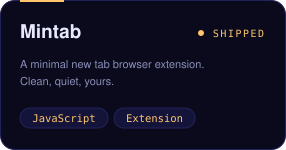

<!-- Header & Intro -->

<picture>

</picture>

  

<!-- CP Profiles -->
<picture>

</picture>
  

  
  
  
  
  

 

<!-- Achievements -->
  
<picture>

</picture>

 

<!-- Projects -->
<picture>

</picture>

<code>Hackathon Builds</code> &nbsp;·&nbsp; <a href="https://github.com/rif-x43/EcoCycle">EcoCycle</a> &nbsp;·&nbsp; ProfMate &nbsp;·&nbsp; CampusOS &nbsp;·&nbsp;

  

<!-- Languages and Tools -->
<picture>

</picture>

<!-- Footer -->
<picture>

</picture>

